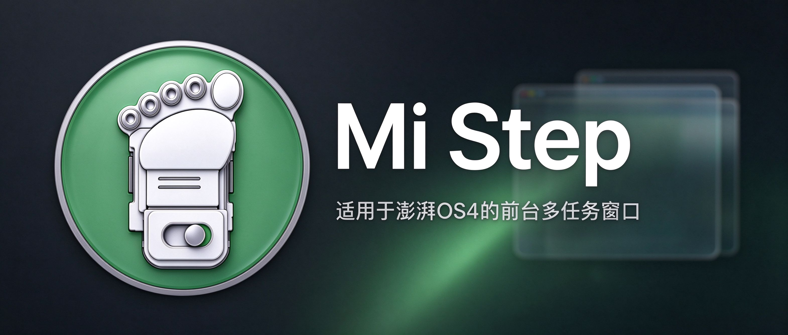
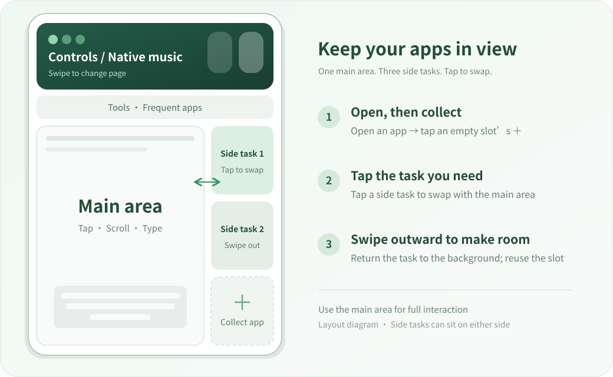
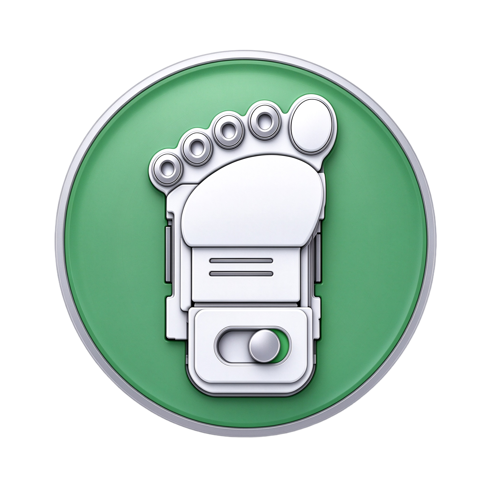

<a href="README.md">简体中文</a> · <strong>English</strong>

  

<h1 align="center">Mi Step · A step forward for Xiaomi</h1>

  <strong>Built for HyperOS 4</strong> 
  One main area, three side tasks. Keep what you are doing in view.

  <kbd>1.0.0</kbd> &nbsp; <kbd>HyperOS 4</kbd> &nbsp; <kbd>Android 17</kbd> &nbsp; <kbd>ARM64</kbd> &nbsp; <kbd>Root + LSPosed</kbd> &nbsp; <kbd>Source available · Noncommercial</kbd>

  <a href="https://github.com/JIUSIS/MiStep/releases/tag/v1.0.0"><strong>Download 1.0.0</strong></a> ·
  <a href="#features">Features</a> ·
  <a href="#installation-and-first-steps">Installation</a> ·
  <a href="#a-note-from-a-wish-making-engineer">Why I made it</a>

---

## Multitasking that feels natural again

Keep notes beside your research. Reply to a message while watching a video. Move between several apps while working on the same thing. I wanted a workspace where I could see these tasks and switch between them easily.

**Mi Step takes inspiration from Smartisan's One Step and brings that approach to foreground multitasking on Xiaomi HyperOS 4.** Your current desktop or app stays in the main area, with three side task slots alongside it. Frequent apps, controls, music and tools sit above. Tap the task you want to use to bring it into the main area.

  
   This is a layout and gesture diagram, not a screenshot. The side tasks can also sit on the left.

## Features

### 01 · One main area, three real side tasks

The main area keeps your current desktop or app usable. Three task slots sit beside it, so you can keep several apps in view.

**The ＋ in an empty slot collects the current main app.** Open the app in the main area, then tap an empty slot to place it there. Open another app and repeat to build your workspace. If the main area shows the desktop, you will be prompted to open an app first.

Side tasks are real system app tasks. Swapping uses the existing tasks and preserves their current pages. Refreshing, process reclamation and playback still depend on the app and Android.

### 02 · Tap to swap; interact in the main area

Tap a side task to bring it into the main area. The previous main app moves into the side task area. Tap another task whenever you want to continue there.

- **Use the main area for full interaction:** tapping, scrolling, typing and the keyboard.
- **Use side tasks to choose and manage tasks:** tap to swap or swipe outward.
- Tapping a frequent app that is already a side task also brings that existing task into the main area.

The main area keeps input focus. Input is briefly protected during a handoff and restored after the final frame, helping prevent accidental touches or the keyboard following a side task.

### 03 · Swipe outward to make room

Swipe a side task toward its nearest screen edge: left for tasks on the left, right for tasks on the right.

The slot becomes empty, and **the task returns to the system background without being deliberately closed**. You can reopen it through the desktop, recent apps or the frequent app rail.

### 04 · Frequent apps, within reach

The top rail shows up to 18 apps, ordered by foreground usage over the last seven days. If usage statistics are unavailable, app names and other metadata provide a stable fallback order.

| Gesture | Action |
| --- | --- |
| Tap an app icon | Open it in the main area, or swap its existing side task into the main area |
| Swipe the rail horizontally | Browse icons outside the visible portion |
| Long press, drag horizontally, then release | Select and open an app |
| Tap the previous or next toolbar arrow | Move to the previous or next frequent app |

### 05 · Controls at the top of your workspace

Use common switches and system shortcuts without leaving the workspace. **Swipe the top panel horizontally to switch between controls and music.**

| Control | Action |
| --- | --- |
| Wi-Fi, mobile data, Bluetooth | Show their status and use the system controls |
| VPN | Open system VPN settings |
| Volume | Adjust media volume and show its percentage |
| Brightness | Adjust brightness and show its percentage |
| Scan | Choose a WeChat or Alipay scanning entry |
| Payment code, transit code | Choose the relevant app or system wallet entry |
| Device name | Show the device name in the center of the panel |

Scanning, payment and transit shortcuts depend on installed apps and system interfaces. For the WeChat transit code, add the relevant shortcut to the desktop in WeChat first. Mi Step uses that existing shortcut; it does not create payment or transit credentials.

### 06 · Native media controls and synchronized lyrics

The music page uses HyperOS 4's native media controls and follows the media session selected by the system. It shows cover art, title, artist and playback state. Playback, track changes, seeking and output selection use the native controls; the buttons available depend on what the player exposes to Android.

Lyrics follow playback inside the music card, with the current line highlighted and nearby lines visible. Mi Step first checks lyrics supplied by the media session, then tries an online match when needed. Missing matches, instrumental tracks or unavailable services show an appropriate placeholder.

**There is no need to add music players to the module's LSPosed scope.** The current implementation can query NetEase Cloud Music, KuGou, Soda Music and LRCLIB. See [Data and security](docs/数据与安全说明.md) for the song information used by online queries.

### 07 · Text clipboard history

Tap the clipboard icon to see recently copied text. Tap an entry to copy it again, delete individual entries or clear the list.

- Keeps up to **24 entries**, moving duplicates to the front.
- Stores history only in the current process's memory, without a history file.
- Skips entries marked sensitive by the source app and does not read the clipboard while the screen is locked.
- Closes the panel when the screen turns off and clears history when the system user changes.

### 08 · Screenshots, recording and a flashlight

Common tools stay inside the workspace. Button placement adapts to the left or right layout.

| Tool | Action |
| --- | --- |
| Exit arrow | Close Mi Step and restore the normal system interface |
| Gear | Open system settings in the main area |
| Clipboard | Open or close text history |
| Screenshot | Call the system screenshot function |
| Screen recording | Call the system recording function |
| Flashlight | Toggle the system flashlight |
| Previous and next arrows | Move between frequent apps |

The workspace uses a blurred version of the desktop wallpaper, rounded corners and a glass effect. Changing the wallpaper updates the background. The blurred image comes from the wallpaper, not the current app's screen.

### 09 · Left or right layouts and landscape inside Mi Step

Swipe **right from the upper left corner** for side tasks on the left, or **left from the upper right corner** for side tasks on the right.

When an app enters landscape inside the main area, Mi Step coordinates its orientation, touch mapping, task swaps and floating keyboard position. Version 1.0.0 includes fixes for landscape drag direction, keyboard movement limits, rotation ownership during swaps and status bar animations leaving the main area.

This means **an app in landscape inside the Mi Step workspace**. App policies, keyboards and ROM versions can still differ. See the [release notes](docs/发行说明-1.0.0.md) for the actual validation scope.

## Installation and first steps

### Requirements

| Item | Current requirement |
| --- | --- |
| System | Targets **Android 17 / HyperOS 4** |
| Architecture | **ARM64** |
| Framework | Working **Root + LSPosed** |
| Development and validation devices | Xiaomi 17 Pro Max, Redmi Note 11T Pro |

Different ROMs on the same model may expose different interfaces. These targets are not a guarantee of compatibility with every device.

### Enable the module

The permanent package name is **`com.jiusis.mistep`**. Future versions will keep it. If you installed an earlier package name, exit the workspace and disable the old module in LSPosed first. Install this package, enable the new module, select its scope again, then reboot normally. You can uninstall the old module after confirming the new one works. A changed package name cannot overwrite the old installation; do not enable both modules together.

1. Download `MiStep-1.0.0.apk` from the [1.0.0 release](https://github.com/JIUSIS/MiStep/releases/tag/v1.0.0). Check it against `SHA256SUMS.txt` on that page.
2. Install it, enable **Mi Step** in LSPosed and select the recommended scope below.
3. **Reboot normally** so the system processes load the module.
4. With the phone in portrait, use the upper corner swipe gesture. Open an app in the main area, then tap an empty side slot's ＋ to collect it.

| Scope | Package | Purpose |
| --- | --- | --- |
| System framework | `android` | System tasks, main area scaling and input |
| System UI | `com.android.systemui` | Workspace, toolbar and native controls |
| Settings | `com.android.settings` | Settings interface adaptation |
| Xiaomi keyboard | `com.xiaomi.type` | Select when using the Xiaomi keyboard |

The module has no separate launcher screen. Enter through the gestures after installation. The gear opens system settings. See the [full usage guide](docs/使用说明.md) for upgrades, signing and recovery. The linked detailed guides are currently in Chinese.

### Try a small workspace

Open a browser in the main area and tap ＋ to collect it. Open your notes and collect them into a second slot, then return to your chat app. You can now keep your reference material visible while replying. Tap your notes to add a few lines, then tap the chat to return. Swipe a side task outward when you need the slot for something else.

## A note from a wish-making engineer

  

The reason I started Mi Step is simple: Xiaomi's floating windows never felt quite right to me, and I kept thinking about Smartisan's original One Step 3.0.

My background is in arts, sports and humanities. Before AI, writing code felt far out of reach. When I tried DS and MiMo in May, I realized AI could give me abilities and a kind of efficiency I had never had before. Later, with GPT as my teacher, I learned faster. I kept talking with it, learning and gradually putting my ideas into clearer words.

I still cannot write code fluently. But I have been learning to work like a product assistant: describe what I need, arrange tasks, watch the results and explain what is wrong. Somewhere along the way, I ended up making three or four little “toys.”

I only really decided to make Mi Step after trying the community projects **OneStep4** and **Van Step**. Thank you to their creators for sharing their work. Trying them also helped me understand what I wanted: the ease of using Smartisan's original One Step 3.0 as I remembered it.

So I tried programming through natural language to make a version closer to my own ideas. To my surprise, it worked, and the first version felt worth continuing. I named it **Mi Step**. The name might sound like Xiaomi's step counter, but I meant it as “a step forward for Xiaomi,” following the idea behind One Step.

As this “wish-making engineer,” I believe sharing knowledge helps ideas meet. Sharing what we have made, the mistakes we have made and what we have learned seems better than everyone taking the same wrong turns alone.

I also hope we can bring back some of the straightforward, friendly exchange I remember from the old Cool Market and MIUI forums. A little less hostility, a little more help. We can discuss a project, point out its problems and help each other take another step forward.

## Inspiration and thanks

| Project | Connection to Mi Step |
| --- | --- |
| [SmartisanTech / android](https://github.com/SmartisanTech/android) | Smartisan's official source entry; One Step's interaction model inspired this project |
| [SangLuoCN / OneStep4](https://github.com/SangLuoCN/OneStep4) | A community project I tried that encouraged me to make my own |
| [Van Step](https://github.com/Xposed-Modules-Repo/com.hyper.sidebar) | A community project I tried that encouraged me to make my own |

Mi Step is a personal project, not an official Xiaomi, Smartisan or community project release. These acknowledgments recognize the experience and inspiration; they do not imply participation in development, endorsement or compatibility guarantees.

## Documentation, feedback and source

| Topic | Start here |
| --- | --- |
| Installation, gestures, upgrades and recovery | [Usage guide](docs/使用说明.md) |
| Changes and validation scope in 1.0.0 | [Release notes](docs/发行说明-1.0.0.md) |
| Building and running tests | [Build guide](docs/构建说明.md) |
| Lyrics queries, clipboard and data | [Data and security](docs/数据与安全说明.md) |
| Release content checks | [Release checks](docs/安全检查-1.0.0.md) |
| Third-party components and licenses | [Third-party notices](THIRD_PARTY_NOTICES.md) |
| Noncommercial use and modified releases | [License guide](docs/许可说明.md) · [Full license](LICENSE) |
| Reporting issues and contributing | [Contributing](CONTRIBUTING.md) |

When reporting an issue, include the device, ROM version, Mi Step version, app or keyboard and exact steps. For landscape issues, distinguish landscape inside Mi Step from rotating the whole phone. Screenshots or recordings help; hide chats, account details and other personal information before sharing them.

<strong>For anyone who wants to explore the source</strong>

Workspace and system adaptation code lives in `module/src/main/java/`, and native input mapping in `module/src/main/cpp/`. `tests/` and `tools/` contain policy checks, production method replays and package checks. On Windows, `build.ps1` and `test.ps1` build and test the complete source. Tools and commands are listed in the build guide.

The release includes an APK, product source ZIP, build information and SHA-256 checksums. The repository excludes signing keys, account credentials, device logs, personal screenshots or recordings, and vendor ROMs. The brand images were provided specifically for the project introduction.

I want to keep sharing what I learn, and I do not want someone to put a new shell around everyone's work and sell it. Mi Step's original content uses the [Mi Step Noncommercial Share-Alike Source License 1.0](LICENSE): noncommercial use, study, modification and free sharing are allowed. Distributed derivatives must include the complete corresponding source, retain attribution and use the same license.

## License: help improve it; please do not repackage it for sale

**Noncommercial sharing is allowed. Commercialization is prohibited. Distributed derivatives must provide complete corresponding source under the same license.**

| What you want to do | Rule |
| --- | --- |
| Use, study or privately modify it | Allowed for noncommercial purposes; private modifications need not be published |
| Share the original or release a free modified version | Retain attribution and the license; provide the complete source for that version |
| Rename it or change its interface and sell it | Prohibited |
| Charge for downloads, paid features or subscriptions; monetize ads or paid bundles | Prohibited |
| Distribute a modified version without its source | Prohibited |

This is **source-available software** under a custom license, `LicenseRef-MiStep-NC-SA-1.0`. Because it restricts commercial use, it is **not an OSI-approved open source license** and is not GPL-3.0. GPL-3.0 permits commercial use and paid distribution. The full conditions are in [LICENSE](LICENSE); **the Chinese license text controls**, and this English README is a reading aid, not a separate license grant.

The license also covers the original portions of the official 1.0.0 artifacts. Third-party components retain their own licenses. Source disclosure does not include signing keys, credentials or personal device material.

---

<strong>Mi Step · A step forward for Xiaomi</strong> Put an idea into words, make it something you can use, then take the next step together.

