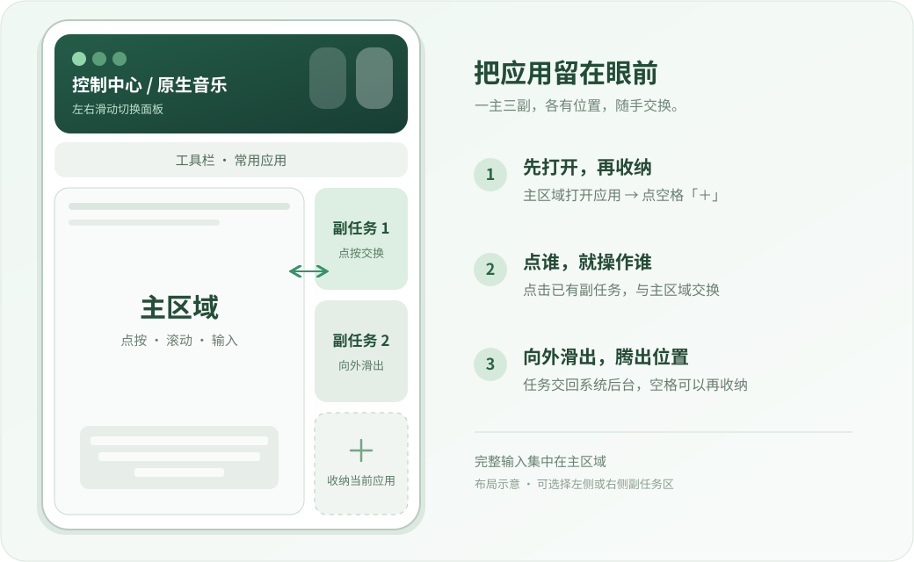

  

<h1 align="center">Mi Step · 小米的步伐</h1>

  <strong>真·适配 HyperOS 4</strong> 
  一个主区域，三个副任务，把正在做的事留在眼前。

  <kbd>1.0.0</kbd> &nbsp; <kbd>HyperOS 4</kbd> &nbsp; <kbd>Android 17</kbd> &nbsp; <kbd>ARM64</kbd> &nbsp; <kbd>Root + LSPosed</kbd>

  <a href="https://github.com/JIUSIS/MiStep/releases/tag/v1.0.0"><strong>下载 1.0.0</strong></a> ·
  <a href="#功能详解">功能详解</a> ·
  <a href="#安装与上手">安装与上手</a> ·
  <a href="#一个许愿工程师的自述">项目缘起</a>

---

## 一步，回到顺手的多任务

查资料时留着笔记，看视频时顺手回消息，在几个应用之间来回处理同一件事——我想要的，是把这些事情放在一个看得见、切得动的工作区里。

**Mi Step 参考锤子科技 One Step「一步」的交互思路，为小米 HyperOS 4 适配前台多任务体验。** 当前桌面或应用显示在主区域，旁边留出三个副任务位置，上方放常用应用、控制中心、音乐和工具。需要操作哪个任务，就点它换到主区域。

  
   布局与操作示意，并非实际界面截图；副任务区也可以放在左侧。

## 功能详解

### 01 · 一个主区域，三个真实副任务

主区域保留当前桌面或应用的操作空间；三个副任务按格排列，与主区域并排显示，方便同时查看几个应用的内容。

**空格上的「＋」用来收纳当前主应用。** 先在主区域打开要留下的应用，再点一个空副任务格，它就会进入那个位置。继续打开其它应用、继续收纳，逐步搭好自己的工作区。主区域是桌面时，会提示先打开应用。

副任务承载的是系统中的真实应用任务。切换围绕已有任务进行，保留任务当前的页面；应用自身的刷新、后台回收和播放策略仍由应用及系统决定。

### 02 · 点一下交换，把输入留给主区域

点击已有副任务，它会进入主区域，原主应用则交给副任务区。用完再点另一个任务，就能继续接着做事。

- **主区域负责完整操作**：点击、滚动、输入文字和使用键盘。
- **副任务区负责选择与管理**：点按交换、向外滑出。
- 点击常用应用栏中已在副区的应用，也会将已有任务换回主区域。

主区域保持输入焦点；任务交接时保留短暂的输入保护，完成后继续操作，减少误触或键盘跑到副任务上的情况。

### 03 · 向外滑出，给下一个任务腾位置

暂时不用某个副任务时，向它所在的屏幕外侧滑出：副区在左边就向左，副区在右边就向右。

滑出完成后，该位置恢复为空格，**任务交回系统并留在后台，不主动结束应用**。之后可以从桌面、最近任务或常用应用入口继续打开它。

### 04 · 常用应用栏，少走几次桌面

顶部应用栏提供快速入口，按最近七天的前台使用情况排列，最多展示 18 个应用；无法读取使用统计时，使用应用名称等信息保持稳定排序。

| 操作 | 作用 |
| --- | --- |
| 点击应用图标 | 在主区域打开应用；已在副区时交换已有任务 |
| 左右滑动应用栏 | 浏览当前没有露出的图标 |
| 长按后横向拖动，松手 | 选择并打开目标应用 |
| 点击工具栏的前后箭头 | 切换到上一个或下一个快捷应用 |

### 05 · 控制中心就在工作区顶部

不用离开当前工作区，就能处理常用开关和系统快捷入口。顶部面板支持**左右滑动，在控制页与音乐页之间切换**。

| 控制页内容 | 可以做什么 |
| --- | --- |
| Wi-Fi、移动数据、蓝牙 | 查看对应状态，调用系统开关 |
| VPN | 打开系统 VPN 设置入口 |
| 音量 | 调整媒体音量，并显示当前百分比 |
| 亮度 | 调整屏幕亮度，并显示当前百分比 |
| 扫一扫 | 选择微信或支付宝的扫一扫入口 |
| 付款码、乘车码 | 选择对应应用或系统钱包入口 |
| 机型信息 | 在面板中央显示当前设备名称 |

扫码、付款和乘车能力依赖已安装应用与当前系统接口。微信乘车码需要先在微信里将相应入口添加到桌面；模块沿用已有快捷方式，不生成付款或乘车凭据。

### 06 · 原生音乐卡片，与播放同步的歌词

音乐页接入 HyperOS 4 的原生媒体控件，跟随系统当前选择的媒体会话，显示封面、歌名、歌手及播放状态。播放/暂停、切歌、进度拖动和输出设备入口沿用原生控件；实际可用按钮取决于播放器提供给系统的能力。

歌词在音乐卡片内随播放进度显示，当前行高亮，旁边保留上下文。优先读取媒体会话自带歌词，缺失时再尝试在线匹配；无匹配、纯音乐或服务不可用时，会显示相应占位提示。

**取词不需要额外勾选播放器的 LSPosed 作用域。** 当前实现可查询网易云音乐、酷狗、汽水音乐及 LRCLIB 等来源，在线查询涉及的歌曲信息见 [数据与安全说明](docs/数据与安全说明.md)。

### 07 · 文本剪贴板，复制过的内容随手找回

点击剪贴板图标，可查看最近复制的文本：点击条目重新复制，支持单条删除和一键清空。

- 最多保留 **24 条**，重复文本移到前面。
- 历史仅保存在当前进程内存中，不写入历史文件。
- 不收录被来源应用标记为敏感的条目；锁屏时不读取剪贴板。
- 熄屏时收起面板，切换系统用户时清空历史。

### 08 · 截图、录屏、手电筒，一排就够用

工具栏把常用操作放在工作区内，左右布局下会调整按钮位置。

| 工具 | 作用 |
| --- | --- |
| 退出箭头 | 退出 Mi Step，恢复普通系统界面 |
| 齿轮 | 在主区域打开系统设置 |
| 剪贴板 | 展开或收起文本历史面板 |
| 截图 | 调用系统截图功能 |
| 录屏 | 调用系统录屏功能 |
| 手电筒 | 切换系统手电筒 |
| 前后箭头 | 在快捷应用之间切换 |

工作区使用桌面壁纸生成模糊背景，配合圆角和玻璃质感；更换壁纸后会更新背景。模糊素材来自壁纸，不取当前应用画面。

### 09 · 左右布局，以及一步内部的横屏

从**左上角向右**滑动，副任务区在左；从**右上角向左**滑动，副任务区在右，可以按左右手习惯选择。

应用在一步主区域内进入横屏时，工作区会协调页面方向、触摸映射、主副交换和悬浮键盘位置。1.0.0 已包含横屏拖动方向、键盘左右移动范围、交换时旋转归属，以及横竖屏状态栏动画越界的修正。

这里的横屏指**一步区域内的应用横屏**。不同应用的横屏策略、输入法和系统版本仍可能带来兼容差异，具体测试边界见 [发行说明](docs/发行说明-1.0.0.md)。

## 安装与上手

### 运行环境

| 项目 | 当前要求 |
| --- | --- |
| 系统 | 适配目标为 **Android 17 / HyperOS 4** |
| 架构 | **ARM64** |
| 框架 | 已配置可用的 **Root + LSPosed** |
| 开发与验证设备 | Xiaomi 17 Pro Max、Redmi Note 11T Pro |

相同机型、不同 ROM 也可能有接口差异；当前适配范围不等于全机型兼容承诺。

### 启用模块

1. 从 [1.0.0 发行页](https://github.com/JIUSIS/MiStep/releases/tag/v1.0.0) 下载 `MiStep-1.0.0.apk`，可用同页的 `SHA256SUMS.txt` 核对文件。
2. 安装后，在 LSPosed 中启用 **Mi Step**，选择模块推荐作用域。
3. **正常重启手机**，使系统进程加载模块。
4. 在竖屏界面用上角横滑手势打开工作区，先在主区域打开一个应用，再点副格「＋」收纳。

推荐作用域如下：

| 作用域 | 包名 | 说明 |
| --- | --- | --- |
| 系统框架 | `android` | 系统任务、主区域缩放与输入适配 |
| 系统界面 | `com.android.systemui` | 工作区、工具栏与原生控件 |
| 设置 | `com.android.settings` | 设置界面适配 |
| 小米输入法 | `com.xiaomi.type` | 使用小米输入法时按推荐选择 |

模块没有独立桌面启动界面，安装后通过上述手势进入。齿轮按钮打开的是系统设置。覆盖升级、签名与停用恢复步骤见 [完整使用说明](docs/使用说明.md)。

### 第一次搭工作区，可以这样试

在主区域打开浏览器，点空格「＋」收纳；再打开笔记，收进第二格；然后回到聊天应用。现在可以看着资料回消息，点笔记换到主区域补几句，再点聊天换回来。需要腾位置时，把暂时不用的副任务向外滑出即可。

## 一个“许愿工程师”的自述

  

做 Mi Step 的起因其实很简单：我一直觉得小米的悬挂小窗不太顺手，也一直惦记着锤子原版的一步 3.0。

我是个“艺体文”，在 AI 出现之前，敲代码这件事对我来说实在太遥远。今年五月接触到 DS 和 MiMo 后，我才发现，AI 能让我获得一些以前很难拥有的能力和效率。后来有了 GPT 老师，学得更快了，我就不断地和它交流、学习，把自己的想法一点点讲清楚。

到现在，我还是不会熟练地敲代码。但我慢慢学着站在产品助理的位置上，描述需求、安排任务、观察效果、反馈问题。就这样，前前后后也做出了三四个小“玩具”。

Mi Step 则是在我体验了社区大佬的 **OneStep4** 和 **Van Step** 之后，才真正想动手做的。感谢他们把作品带到社区，也让我更确定了自己想要的体验：我想找回的，是自己记忆里锤子原版一步 3.0 的那种顺手。

于是，我试着用自然语言编程，做一个更贴近自己想法的一步。没想到，还真做出来了，初版效果也让我觉得值得继续。我给它取名 **Mi Step**。这名字可能会让人联想到“小米步数”，但我的意思是：既然脱胎于 One Step 的想法，那就叫它“小米的步伐”。

本“许愿工程师”相信，知识分享才会带来头脑风暴。把做过的东西、踩过的坑和摸索出来的经验拿出来交流，总比各自关起门来走弯路好。

我也希望，我们还能找回当年“酷市场”和“MIUI 论坛”里那种纯粹的交流氛围。社区少一点戾气，多一点互相帮助；作品可以讨论，问题可以指出，每个人也都可以在别人的帮助下往前走一步。

## 参考与致谢

| 项目 | 与 Mi Step 的关系 |
| --- | --- |
| [SmartisanTech / android](https://github.com/SmartisanTech/android) | 锤子科技官方开源入口；One Step 的交互思路是本项目的参考起点 |
| [SangLuoCN / OneStep4](https://github.com/SangLuoCN/OneStep4) | 我体验过、并促使我动手尝试的社区作品 |
| [Van Step](https://github.com/Xposed-Modules-Repo/com.hyper.sidebar) | 我体验过、并促使我动手尝试的社区作品 |

Mi Step 是个人项目，并非小米、锤子科技或上述社区项目的官方产品。对社区作品的致谢表示体验与创作启发，不代表它们参与开发、为本项目背书或提供兼容保证。

## 文档、反馈与源码

| 想了解什么 | 从这里开始 |
| --- | --- |
| 安装、手势、升级与恢复 | [使用说明](docs/使用说明.md) |
| 1.0.0 改动与验证范围 | [发行说明](docs/发行说明-1.0.0.md) |
| 从源码构建和运行测试 | [构建说明](docs/构建说明.md) |
| 歌词查询、剪贴板与数据范围 | [数据与安全说明](docs/数据与安全说明.md) |
| 发布内容检查 | [安全检查](docs/安全检查-1.0.0.md) |
| 第三方组件及许可 | [第三方说明](THIRD_PARTY_NOTICES.md) |

反馈问题时，请说明手机型号、系统版本、Mi Step 版本、应用/输入法名称和具体操作顺序。涉及横屏时，也请说明是一步内部横屏还是整机横屏。截图或录像能帮助说明问题，发送前请遮住聊天、账号等个人信息。

<strong>给想看源码、一起折腾的朋友</strong>

工作区与系统适配代码位于 `module/src/main/java/`，原生输入映射位于 `module/src/main/cpp/`；`tests/`、`tools/` 提供策略测试、生产方法回放和包检查。Windows 下可通过 `build.ps1`、`test.ps1` 完整构建与测试，所需工具及命令见构建说明。

发行页提供 APK、产品源码 ZIP、构建信息及 SHA-256 清单。仓库不包含本机签名私钥、账号凭据、设备日志、个人截图录像或厂商 ROM；文档中的品牌图片是为项目介绍单独提供的素材。

我希望按开源精神交流和分享。目前仓库仍为私有，Mi Step 自有代码尚未附加开源许可证；实际公开范围和授权以仓库正式声明为准。第三方组件继续遵循各自许可。

---

<strong>Mi Step · 小米的步伐</strong> 把想法讲出来，把体验做出来，再一起往前走一步。

